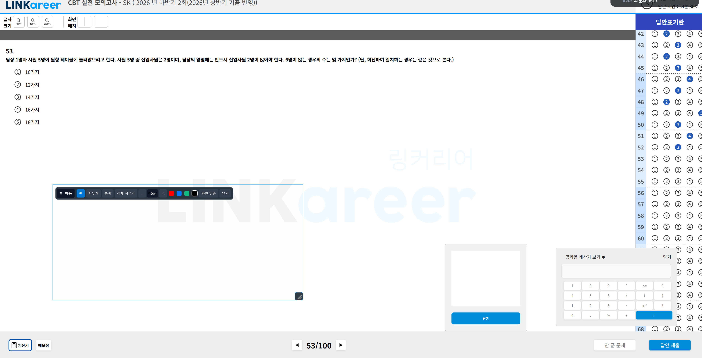

# SKCT Overlay Paint

Chrome 등 현재 사용 중인 창 위에 그리는 Windows용 오버레이 그림판입니다. 모든 오버레이 창은 마우스로 눌러도 활성화되지 않도록 설정되어 있어, Chrome의 키보드 포커스를 유지합니다.

**다운로드:** [Windows x64 실행 파일](https://github.com/controlguy-ys/SKCTOverlayPaint/releases/latest/download/SKCTOverlayPaint.exe)



## 사용법

1. `release/SKCTOverlayPaint.exe`를 실행합니다.
2. **펜**으로 그리거나 **지우개**로 필요한 부분만 지웁니다. `−`/`+`로 굵기를 바꾸고 색을 선택할 수 있습니다.
3. Chrome을 클릭해서 조작할 때는 **통과**를 누릅니다. 다시 그리려면 **펜** 또는 **지우개**를 누릅니다.
4. **전체 지우기**는 모든 선을 삭제합니다.
5. 왼쪽 **이동** 영역을 끌어 오버레이를 옮기고, 오른쪽 아래 손잡이를 끌어 크기를 바꿉니다. **화면 맞춤**으로 기본 위치와 크기를 복원합니다.
6. **닫기**로 종료합니다.

그리기 모드에서는 오버레이가 마우스 입력을 받으므로, 그 영역 아래의 웹 페이지를 클릭하려면 통과 모드로 바꿔야 합니다. 그리기, 지우기, 막대 조작, 크기 조절 중에도 기존 창을 활성화 상태로 둡니다. 선은 실행 중에만 보관됩니다.

## 빌드

Windows x64 환경에서 .NET 8 SDK 이상을 사용합니다.

```powershell
dotnet publish .\SKCTOverlayPaint.csproj -c Release -o .\release -p:DebugType=None
```

빌드 결과는 단일 실행 파일 `release/SKCTOverlayPaint.exe`입니다. .NET 런타임을 별도로 설치할 필요가 없습니다.
